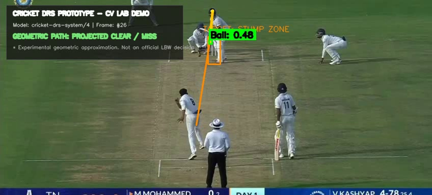
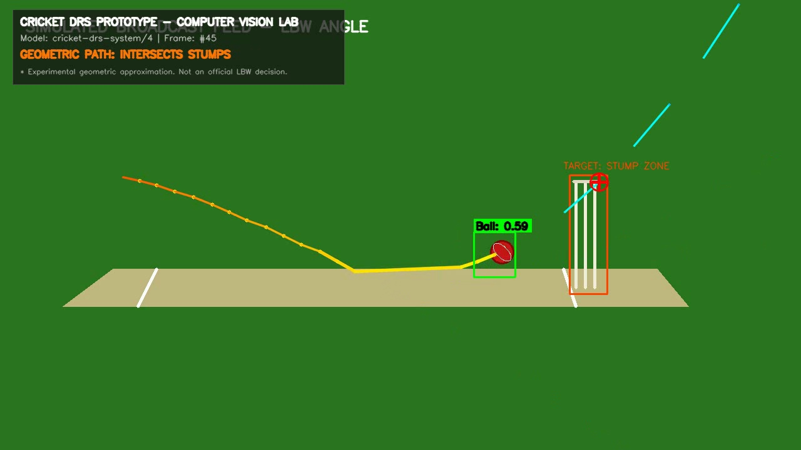
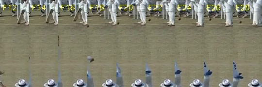
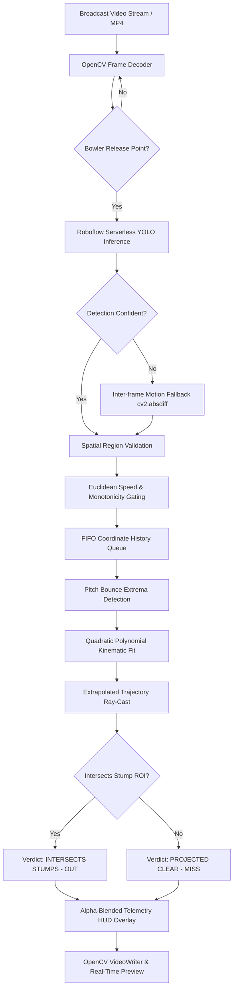

# 🏏 Hawk-Eye DRS: AI Cricket Ball Tracking & LBW Trajectory Prediction

[](https://www.python.org/)
[](https://opencv.org/)
[](https://roboflow.com/)
[](https://numpy.org/)
[](LICENSE)
[]()

> An end-to-end Computer Vision & Kinematic Ballistics pipeline simulating the **Decision Review System (DRS)** used in international cricket. It combines deep-learning object detection, temporal velocity gating, pitch bounce detection, and second-order polynomial trajectory extrapolation to project delivery paths and evaluate Leg Before Wicket (LBW) stump collisions.

---

## 📸 Visual Demonstration & HUD Telemetry

| Ball Tracking & Dynamic Trajectory Arc | Stump Intersection & Collision Verdict |
| :---: | :---: |
|  |  |
| *Real-time ball detection with glowing FIFO historical trajectory trail.* | *Ballistic parabolic projection intersecting striker's wicket zone.* |

### Delivery Sequence & Pitch Progression Strip

*Multi-frame temporal progression tracking bowler release, pitch bounce point, and forward trajectory towards batsman.*

---

## 🌟 Resume & Engineering Highlights

This project demonstrates core competencies across **Applied Computer Vision, Numerical Ballistics, and Systems Engineering**:

- **Deep Learning + Edge Object Detection**: Built with YOLO-based architecture hosted on Roboflow Serverless API (`cricket-drs-system/4`), detecting fast-moving cricket balls with sub-second inference.
- **Robust Outlier Rejection & False-Positive Gating**: Implemented dynamic Euclidean velocity filters ($d = \sqrt{\Delta x^2 + \Delta y^2}$) and spatial mask rejection (e.g., ignoring stationary umpire hats, batsman equipment, and pitch markings).
- **Temporal Motion Fallback**: Integrated inter-frame temporal differencing (`cv2.absdiff` + contour bounding) to maintain ball tracking across extreme motion blur and high-speed delivery frames where pure bounding-box models miss.
- **Physics-Based Trajectory Extrapolation**: Developed a bounce-aware trajectory estimator that detects vertical pitch rebound extrema and fits a second-order polynomial ($y = ax^2 + bx + c$) modeling gravitational ballistic flight ($y(t) = y_0 + v_{0y}t + \frac{1}{2}gt^2$).
- **Geometric Collision Engine**: Configurable 2D Region of Interest (ROI) around the wicket with real-time vector ray-casting to evaluate stump impact and display definitive LBW verdicts.
- **Production-Grade HUD & Video Compositor**: Designed an alpha-blended telemetry HUD overlay, dynamic color-gradient trajectory ribbons, and low-latency frame-by-frame MP4 video writer.

---

## 🏗️ System Architecture & Data Pipeline



---

## 📊 Custom CV Logic vs. Off-The-Shelf Detection

To prevent common "YOLO wrapper" misconceptions, here is the architectural breakdown of custom algorithmic engineering vs. the raw detection API:

| Pipeline Stage | Model Output (`cricket-drs-system/4`) | Custom Implemented CV & Math Engine |
| :--- | :--- | :--- |
| **Object Localization** | Raw bounding boxes `(x, y, w, h)` | - |
| **Noise Filtering** | Float confidence `0.0 - 1.0` | Spatial exclusion masks & adaptive confidence thresholds |
| **Temporal Tracking** | *None (Stateless, single-frame)* | Multi-frame FIFO coordinate queue with speed bounds |
| **Motion Blur Handling**| *Fails during fast deliveries* | Frame differencing contour fallback along pitch corridor |
| **Pitch Bounce Detection**| *None* | Temporal coordinate derivative extrema detection |
| **Flight Extrapolation**| *None* | Second-order kinematic polynomial fit ($y = ax^2 + bx + c$) |
| **Collision Verdict** | *None* | 2D bounding volume intersection & crosshair targeting |
| **Broadcast Graphics** | *None* | Neon alpha-blended HUD telemetry & gradient trail rendering |

---

## 📁 Repository Structure

```text
DRS-System/
├── cricket.mp4              # Sample short delivery clip
├── demo1.mp4                # Medium-pace broadcast delivery test clip
├── demo2.mp4                # Spin delivery test clip
├── data.yaml                # YOLO dataset configuration
├── main.py                  # Core DRS detection, tracking & rendering pipeline
├── test_roboflow.py         # Diagnostic utility to verify Roboflow API connectivity
├── generate_sample_clip.py  # Script for generating synthetic benchmark video
├── requirements.txt         # Pinned Python package dependencies
├── .env.example             # Template for API credentials
├── .gitignore               # Ignored environments, cache & secrets
├── outputs/                 # Exported annotated videos & telemetry figures
│   ├── demo1_annotated_f25.jpg
│   ├── demo_frame_hit.jpg
│   ├── pitch_delivery_strip.jpg
│   └── drs_demo.mp4
└── train/, test/, valid/    # Ground-truth annotated dataset splits
```

---

## ⚡ Quickstart & Installation

### 1. Prerequisites
- **Python 3.10+** (Tested on Python 3.10, 3.11, 3.12)
- Git & virtual environment manager

### 2. Clone the Repository
```bash
git clone https://github.com/hitanshuagrawal/DRS-System.git
cd DRS-System
```

### 3. Create & Activate Virtual Environment
- **Windows (PowerShell):**
  ```powershell
  python -m venv venv
  .\venv\Scripts\Activate.ps1
  ```
- **Linux / macOS:**
  ```bash
  python3 -m venv venv
  source venv/bin/activate
  ```

### 4. Install Dependencies
```bash
pip install -r requirements.txt
```

### 5. Configure API Credentials
Copy the example environment file and insert your [Roboflow](https://roboflow.com) API key:
```bash
cp .env.example .env
```
Edit `.env`:
```env
ROBOFLOW_API_KEY=your_actual_roboflow_key_here
ROBOFLOW_MODEL_ID=cricket-drs-system/4
```

---

## 🚀 Execution & Command-Line Options

### Run Default Demonstration
```bash
python main.py --input demo1.mp4
```

### Export Annotated Video to File
```bash
python main.py --input demo1.mp4 --output outputs/drs_demo.mp4
```

### Optimize API Usage with Frame Step Sampling
Process every 2nd frame (speeds up inference while maintaining smooth kinematic interpolation):
```bash
python main.py --input demo2.mp4 --step 2
```

### Calibrate Stump Target Box for Different Broadcast Angles
Customize the target stump bounding box `(x1, y1, x2, y2)`:
```bash
python main.py --input cricket.mp4 --stump-box 910 280 970 470
```

### Full CLI Options Reference
| Argument | Type | Default | Description |
| :--- | :--- | :--- | :--- |
| `--input` | `str` | `cricket.mp4` | Path to input delivery video file |
| `--output` | `str` | `outputs/drs_demo.mp4` | Path to save annotated output MP4 |
| `--step` | `int` | `1` | Frame sampling stride (e.g., 2 = every second frame) |
| `--stump-box` | `int x4` | `910 280 970 470` | Striker stump bounding box coordinates `(x1 y1 x2 y2)` |
| `--release` | `int` | `1` | Bowler delivery release frame index |
| `--no-preview` | `flag` | `False` | Run in headless mode without local GUI window |

---

## 🔬 Mathematical & Kinematic Formulation

### 1. Gravitational Ballistic Flight
Under Newtonian kinematics, projectile motion in an image plane with vertical axis $y$ satisfies:
$$y(t) = y_0 + v_{0y}t + \frac{1}{2}gt^2$$
Because delivery frames advance uniformly ($\Delta t = 1/\text{FPS}$), future ball coordinates are modeled by a degree-2 polynomial fit:
$$\hat{x}(y) = c_2 y^2 + c_1 y + c_0 \quad \text{or} \quad \hat{y}(x) = c_2 x^2 + c_1 x + c_0$$
determined using least-squares polynomial regression on the post-bounce coordinate history.

### 2. Pitch Bounce Extrema Identification
In inverted screen coordinates (origin $(0, 0)$ at top-left), a ball moving toward the pitch experiences increasing $y$. At pitch impact, vertical velocity reverses ($v_y < 0$), producing a local maximum in $y$:
$$y_{\text{bounce}} = \arg \max_{t} y(t)$$
Fitting trajectories exclusively to points where $t > t_{\text{bounce}}$ guarantees physically authentic forward projections without inverted rebound distortion.

---


## 📜 License
This project is open-source under the [MIT License](LICENSE).
